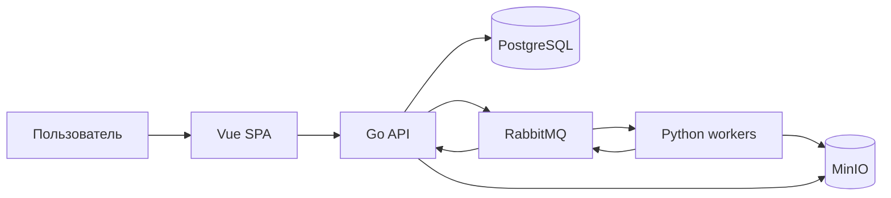

# Архитектура MVP

## Общий подход

GraphX начинаем как модульный монолит, а не как набор микросервисов. Серверное ядро собирается в одно Go-приложение, но внутри делится на независимые предметные модули. Сбор и разбор внешних данных вынесен в Python workers, потому что для этой работы экосистема Python удобнее.

Такой вариант даёт команде из трёх человек понятные границы без лишней инфраструктуры.



## Компоненты

### Web

Vue 3, Vite и TypeScript. Клиент показывает ход расследования, результаты отдельных источников, запросы на подтверждение, граф и доказательства. Nuxt для MVP не нужен: серверный рендеринг не даёт заметной пользы внутреннему аналитическому приложению.

### Go API

Go-приложение владеет бизнес-состоянием и базой данных. В нём находятся:

- расследования и их этапы;
- планирование заданий источникам;
- transactional outbox и обработчики результатов;
- entity resolution и пользовательские решения;
- сущности, фактические связи и представления для интерфейса;
- REST API.

Gin используется как HTTP-адаптер. Предметная логика не должна зависеть от Gin.

### Python workers

Единый Python-пакет содержит адаптеры источников, загрузку документов, parsers и mappers. Worker не подключается к PostgreSQL и не меняет бизнес-состояние напрямую. Он получает самодостаточную команду, сохраняет крупные исходные данные в MinIO и публикует результат.

В MVP это один тип развёртывания. Отдельные worker-процессы для браузера или тяжёлого разбора появляются только при реальной необходимости.

### PostgreSQL

Единственный источник истины для состояния расследования, заданий, извлечённых утверждений, сущностей, решений и связей. Доступ из Go - через `pgx`, запросы пишутся явно. Миграции - `goose` и обычный SQL.

### RabbitMQ

Передаёт команды workers и результаты обратно в Go. Очередь не заменяет `source_jobs`: RabbitMQ отвечает за доставку, а таблица - за понятное пользователю состояние работы.

### MinIO

Хранит исходные ответы и документы. Объекты считаются неизменяемыми: исправленный parser создаёт новый результат обработки, а не переписывает исходник.

## Структура репозитория

```text
apps/
├── api/                 Go API и серверное ядро
└── web/                 Vue-приложение
workers/                 Python workers и адаптеры
contracts/               OpenAPI и JSON Schema
db/migrations/           SQL-миграции goose
deploy/                  локальное окружение и будущий deploy
docs/                    документация проекта
testdata/                общие тестовые данные
landing/                 статический лендинг и визуальный образец
```

Код конкретного компонента остаётся внутри его каталога. Общий контракт выносится в `contracts` только тогда, когда его действительно используют две стороны.

## Границы модулей Go

Рекомендуемые модули:

- `investigations` - жизненный цикл расследования;
- `orchestration` - задания, повторы и частичный результат;
- `ingestion` - приём и проверка результатов workers;
- `resolution` - кандидаты и решения о совпадениях;
- `knowledge` - сущности, утверждения и фактические связи;
- `readmodels` - граф, timeline и экранные представления;
- `platform` - PostgreSQL, RabbitMQ, MinIO, HTTP и наблюдаемость.

Модули общаются через явно определённые интерфейсы и предметные типы. Нельзя обращаться к таблицам чужого модуля из случайного места только потому, что они находятся в одной базе.

## Владельцы данных

| Данные                        | Кто меняет                                      |
| ----------------------------- | ----------------------------------------------- |
| Расследования и `source_jobs` | Go API и его consumers                          |
| Outbox и inbox                | Go API                                          |
| Исходные объекты MinIO        | Python worker через выданный интерфейс хранения |
| Результаты разбора            | Python публикует, Go проверяет и записывает     |
| Сущности, решения и связи     | Только Go API                                   |
| Состояние доставки сообщения  | RabbitMQ                                        |

## Технологии, которые не нужны в MVP

В MVP не нужны Neo4j, Redis, Kafka, Kubernetes, отдельный workflow engine и обязательная LLM. Любая из этих технологий должна появиться только после измеримой проблемы, которую уже нельзя разумно решить текущим стеком.
