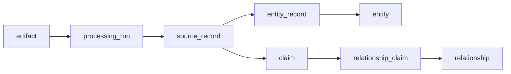
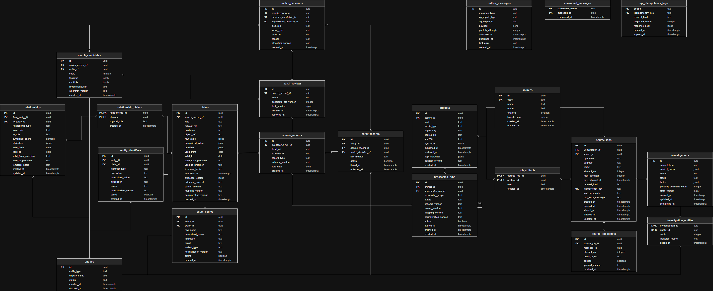

# Модель данных

## Принцип

База должна хранить не только итоговый граф, но и путь от каждой связи до исходного материала. Поэтому исходные данные, извлечённые утверждения, канонические сущности и пользовательские решения разделены.

## Диаграмма связей

[Открыть ERD в полном размере](assets/ERD.drawio.svg)

Диаграмма показывает целевую структуру базы и помогает ориентироваться в связях между таблицами. После добавления SQL-миграций именно они становятся источником истины о фактической схеме базы, а диаграмма должна обновляться вместе с ними.

## Основные таблицы

### Исследования и источники

`investigations` хранит входные данные, этап, общий статус, ограничения, число ожидающих решений и `state_version`. Основные статусы: `created`, `running`, `completed`, `completed_partial`, `failed`, `cancelled`. Этапы: `subject_discovery`, `subject_resolution`, `enrichment`, `analysis`, `completed`.

`sources` - справочник адаптеров: код, название, режим работы, признак включения и порядок запуска. Секретов в этой таблице нет.

`source_jobs` - бизнес-состояние обращения к источнику. Оно не является копией очереди. Поля должны включать расследование, источник, операцию, назначение, status, номер попытки, лимит попыток, время следующего повтора, request hash, idempotency key и сведения об ошибке.

Статусы задания: `pending`, `queued`, `running`, `retry_wait`, `succeeded`, `not_found`, `action_required`, `unavailable`, `failed`, `cancelled`.

Допустимые переходы расследования и задания зафиксированы в [ходе расследования](04-investigation-flow.md#переходы-расследования).

### Исходные материалы и обработка

`artifacts` описывает неизменяемый объект: источник, вид, media type, URI или object key, SHA-256, размер, время публикации и получения, HTTP metadata и версию адаптера. Worker передаёт метаданные объекта, а Go добавляет источник, job и версию адаптера из проверенного результата.

`job_artifacts` связывает задания и материалы с ролью вроде `raw_response`, `document` или `manifest`.

`processing_runs` хранит отдельный запуск parser/mapper: область обработки, версии схемы и кода, статус, связь с заменённым запуском. Для одного artifact и одной области может быть только один активный успешный запуск.

`source_records` - минимальные записи источника, которые можно независимо сопоставить с сущностью. Сохраняются внешний идентификатор, тип, исходный JSON, версия схемы и ссылка на запуск обработки.

`claims` - атомарные проверяемые утверждения. Claim содержит вид (`attribute`, `relationship`, `event`), predicate, исходное и нормализованное значение, qualifiers, временные поля и locator доказательства. Claim не может быть пустым: relationship требует непустую ссылку на объект, attribute - содержательное значение, а event - объект либо значение. Явное отсутствие выражается отдельным predicate и значением, например `has_registration_number = false`, а не неразличимым `null`. Версии parser/mapping/normalization Go берёт из результата обработки и записывает в каждый созданный claim.

Отдельная таблица evidence на старте не нужна: locator и короткий excerpt можно хранить в claim. Она понадобится, если одно утверждение начнут независимо поддерживать много фрагментов разных artifacts.

### Сущности и сопоставление

`entities` хранит канонический объект, его тип, отображаемое имя и статус.

`entity_names` и `entity_identifiers` - нормализованные проекции из claims. Они должны хранить ссылку на claim, исходное значение, версию нормализации и признак актуальной материализации. Для имён также нужны язык, письменность и вид варианта; для идентификаторов - тип, юрисдикция и issuer.

`entity_records` связывает source record с entity. Связь должна быть отменяемой: сохраняются решение, способ связывания, время link/unlink. В один момент у record может быть не больше одной активной entity.

`match_reviews` хранит задачу на проверку совпадения, версию набора кандидатов и `lock_version`.

`match_candidates` хранит кандидата, score, признаки, конфликты и рекомендацию алгоритма. Score - вспомогательная величина, а не вероятность.

`match_decisions` - неизменяемый журнал решений: выбранный кандидат или `none_of_above`, автор решения, причина, версия алгоритма и ссылка на отменённое решение.

### Связи и граф

`relationships` содержит только фактические канонические связи между двумя entities: тип, роли, долю, атрибуты и временные поля. Вычисленные связи и гипотезы сюда не записываются: в MVP они рассчитываются при чтении по правилам из [потока данных](06-data-flow.md#вычисленные-связи-и-гипотезы).

`relationship_claims` связывает факт с подтверждающими claims и указывает роль поддержки.

`investigation_entities` определяет, какие entities входят в конкретное расследование, на какой глубине и почему были добавлены.

Будущие `events` и `event_claims` нужны для удобной материализации назначений, прекращений полномочий и других событий. В первую миграцию их не включаем: сначала проверяем модель на данных KASE.

### Надёжная доставка

`outbox_messages` хранит сообщения, которые нужно опубликовать после транзакции.

`consumed_messages` защищает consumer по паре `consumer_name + message_id`.

`source_job_results` защищает бизнес-операцию от повторного применения одного результата и хранит digest, `applied` и причину игнорирования.

`api_idempotency_keys` защищает повторные команды клиента, например подтверждение кандидата.

## Ограничения и индексы

- внешние ключи индексируются;
- удаление provenance-цепочки ограничивается, каскадное удаление не используется без явной причины;
- статусы хранятся как `text` с `CHECK`, чтобы миграции не зависели от PostgreSQL enum;
- активные связи и материализации защищаются частичными уникальными индексами;
- `pg_trgm` индексируется только по активным нормализованным именам;
- JSONB используется для исходных и действительно источник-зависимых полей, а не вместо нормальной схемы;
- точные интервалы проверяются условием `valid_to > valid_from`; для границ с точностью month, year или approximate учитывается неопределённость, а не только дата-якорь.

## Разбиение миграций

1. Расширения, `investigations`, `sources`.
2. `source_jobs`, outbox, inbox, business deduplication и API idempotency.
3. `artifacts`, `job_artifacts`, `processing_runs`, `source_records`, `claims`.
4. `entities`, `entity_names`, `entity_identifiers`, `entity_records`.
5. Reviews, candidates и decisions.
6. Relationships, supporting claims и состав расследования.
7. Events - после проверки модели на реальных данных.
